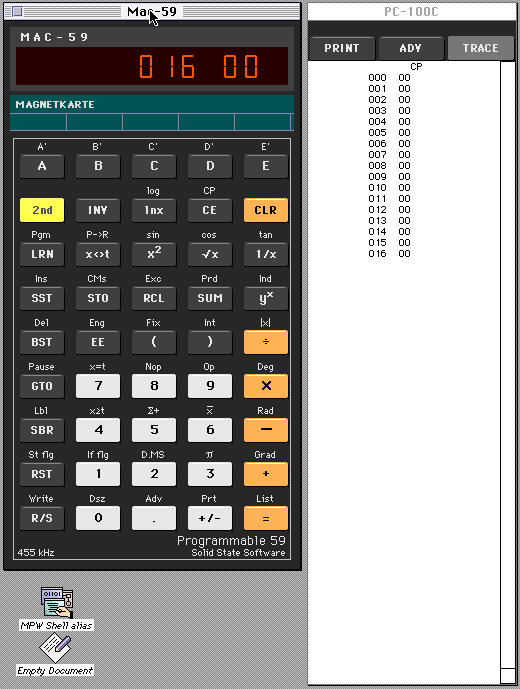
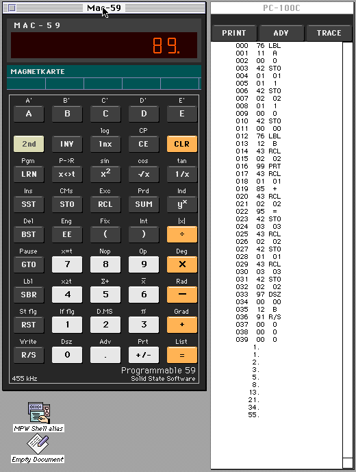

# Mac-59

**The TI-59 programmable calculator (1977) as a classic Macintosh application** — System 7, 68K, with the PC-100C
printer, magnetic cards, the Leisure Library module and a programming course. Mac-59 runs the calculator's own
firmware on an emulated TMC0501 core at the original 455 kHz, so every key, display and printout behaves like the
real machine.

*Deutsch:* Der programmierbare Taschenrechner TI-59 als Programm für den klassischen Macintosh (System 7, 68K), mit
Drucker PC-100C, Magnetkarten, Modul und einem Programmierkurs in 20 Lektionen. Oberfläche, Hilfen und Kurs sind
deutsch.

## The ROM is not included

Mac-59 does **not** contain the TI-59 firmware. The ROM and module images are Texas Instruments' copyrighted
firmware; they are not covered by this repository's licence. The [Calc-U-59](https://github.com/tinue/Calc-U-59)
project provides them as text dumps (read from original chips by the Datamath Calculator Museum). Put these files
into the folder **ROM** next to the application:

| From Calc-U-59 | Files |
|---|---|
| `roms/` | `TMC0582.txt`, `TMC0583.txt`, `TMC0571B.txt`, `TMC0582-CONST-K.txt`, `TMC0583-CONST-K.txt` |
| `roms/solid-state/` (Leisure Library module, optional) | `TMC0547.txt` |

Without them Mac-59 starts, says what is missing and where to get it, and does not calculate. Whoever downloads and
uses the ROM files does so on their own responsibility.

## Download

The [releases](https://github.com/LoetLuemmel/Mac-59/releases) carry the application as MacBinary files (`.bin`):
Mac-59, the empty ROM folder with its note, the ReadMe, the manuals (Programmierkurs, Mars Lander, Mondlandung) and
the course cards. Decode them on the Mac (StuffIt Expander, MacBinary II+) or with a tool that writes both forks.
Tested on System 7.6.1 in Basilisk II.

## What it does

- **Calculator:** all 45 keys with their second functions, the LED display, 455 kHz or full speed.
- **PC-100C printer:** PRINT, ADV, TRACE, listings (`2nd List`, stopped shortly after the program end), paper that
  can be selected, copied, torn off and saved as a SimpleText document.
- **Magnetic cards:** read and written as files (`.u59`, the Calc-U-59 card format); a double-click on a card opens
  Mac-59 and reads it.
- **Leisure Library module:** Mars Lander (program 14) from the menu, with its manual.
- **Mondlandung:** a lunar-lander game carried over from the TI-57 (see *Provenance*), on cards, with a manual.
- **Programmierkurs:** 20 lessons from the keyboard to key codes; a course card opens its lesson.
- **Balloon Help** for every key — the text switches when `2nd` is pending — the menus, the display and the printer.

## Building

Mac-59 is built on the Mac with **Symantec C++ 7** (THINK Project Manager), the **THINK Class Library 2.0** and
**Symantec Visual Architect**:

- `mac59/assemble.py` assembles `CMain.cp` from `mac59/parts/`; the other sources are in `mac59/` and `port/`
  (`TI59Core.cp` is a project file in a segment of its own).
- Resources: `Rez` the `.r` files into the project's resource files (`About.r`, `Menus.r`, `Help.r`, `Ballonhilfe.r`,
  `Bundle.r`, `size.r`); `mkballoons.py`, `mkbundle.py` and `mkstyled.py` generate some of them.
- `TI59.r` builds a *private* app with the ROM inside (from your own dumps via `host-ref/mkblob.cpp`);
  `mac59/mkpublic.py` turns such a build into the public one and checks that no piece of the firmware is left.
- `port/build.sh` builds host-side tests of the core (`coursecheck`, card and ROM-text tests).

The project was developed remotely: the sources were written on a modern Mac and compiled, run and tested on
System 7.6.1 in Basilisk II through [AppleBridge](https://github.com/LoetLuemmel/AppleBridge), together with
Claude Code.

## Provenance and licences

- `upstream/` is a copy of Calc-U-59's emulator core (commit in `upstream/UPSTREAM_COMMIT`), © 2026 Martin
  Erzberger, GPL-3.0. `port/` is derived from it; Mac-59 as a whole is **GPL-3.0** (`LICENSE`, `NOTICE`).
- Mac-59, its manuals and the course: © 2026 Pit Förster.
- **Mondlandung** (`programs/`): Paul Novaes' TI-57 "Lunar Lander" (HP Museum forum, 2022; his RCL-57 sample
  `lander.r57`, [github.com/n3times/rcl57](https://github.com/n3times/rcl57)), after an older program in the French
  magazine *L'Ordinateur de Poche* (author not yet known), carried over to the TI-59 key for key.
- **Trademarks:** TI-59 and Texas Instruments are trademarks of Texas Instruments Incorporated. Mac-59 is not
  affiliated with, endorsed or supported by Texas Instruments.

The course is also online: [td5.390er.de › TI-59 programmieren](https://td5.390er.de/ti-59/ti59-kurs-uebersicht/).
